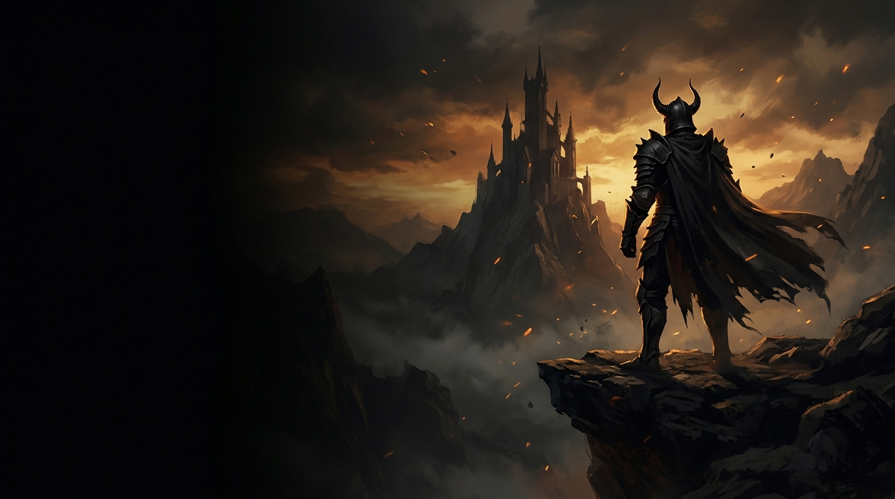

<div align="center">

# ⚔ Return to Castle of Dark — Official Launcher

**Лёгкий и быстрый лаунчер тёмно-фэнтезийного RPG-сервера Minecraft Forge 1.20.1**

[](https://github.com/RtCoD-Stuff/rtcod-launcher/releases/latest)
[](https://files.minecraftforge.net/)
[](https://www.python.org/)
[](https://doc.qt.io/qtforpython-6/)
[](https://discord.com/invite/9mPS3sXq)
[](https://t.me/RtCoD_server)

<br>



</div>

---

## Зачем нужен этот лаунчер?

Больше не нужно вручную скачивать 120+ модов, искать нужную версию Forge и ломать свой основной Minecraft.

| Возможность | Как это работает |
| :--- | :--- |
| **Вход в 1 клик** | Лаунчер сам устанавливает **Minecraft 1.20.1** и **Forge 47.4.28** в отдельную изолированную папку (`RtCoD`). |
| **Авто-Java 17** | Если на компьютере нет Java 17 — лаунчер сам скачает портативную **Adoptium Temurin JRE 17** в свою папку `runtime/`. |
| **Умная синхронизация модов** | При запуске проверяет **SHA-256** каждого файла сборки, докачивает только обновления и убирает лишние/конфликтующие `.jar`. |
| **Чистый интерфейс** | Стиль тёмного средневекового фэнтези: ввод ника, ползунок RAM (`4–12 GB`), защита от двойного запуска и быстрые ссылки в Discord/Telegram. |
| **Кроссплатформенность** | Готовые сборки для **Windows 10/11 (`.exe`)** и **Linux (`x64`)** в разделе [Releases](https://github.com/RtCoD-Stuff/rtcod-launcher/releases/latest). |

---

## Установка для игроков

1. Перейди в [последний релиз](https://github.com/RtCoD-Stuff/rtcod-launcher/releases/latest) и скачай файл под свою систему:
   - **Windows:** `RtCoD-Launcher-Windows.exe`
   - **Linux:** `RtCoD-Launcher-Linux` (`chmod +x RtCoD-Launcher-Linux && ./RtCoD-Launcher-Linux`)
2. Запусти лаунчер, введи свой игровой ник и выдели **6–8 GB RAM**.
3. Нажми **`▶ ИГРАТЬ`** — первый запуск займёт пару минут (загрузка ассетов, Forge и сборки), все последующие будут мгновенными.

---

## Запуск из исходников (для разработчиков)

```bash
git clone https://github.com/RtCoD-Stuff/rtcod-launcher.git
cd rtcod-launcher
pip install -r requirements.txt
python3 run_launcher.py
```

### Тесты
```bash
python3 -m unittest discover -s tests -v
```
